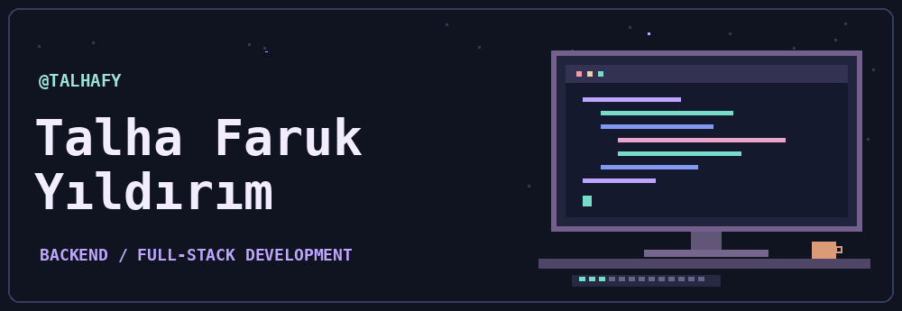
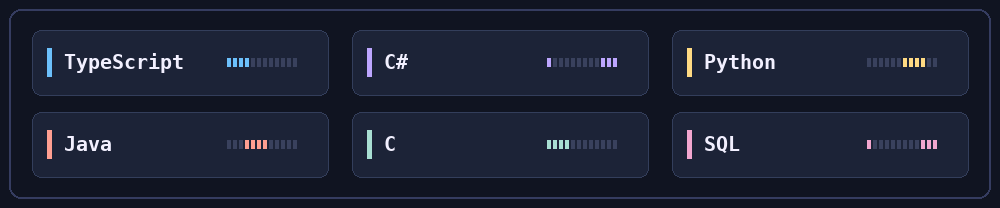
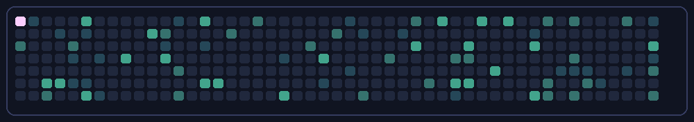

## About me

I'm **Talha Faruk Yıldırım**, a Computer Engineering student at **Sakarya University**. I focus on backend and full-stack development, with an interest in APIs, relational databases, and the web interfaces that bring them together.

## Languages I work with

## Contribution snake

*An animated illustration inspired by GitHub’s contribution grid.*
