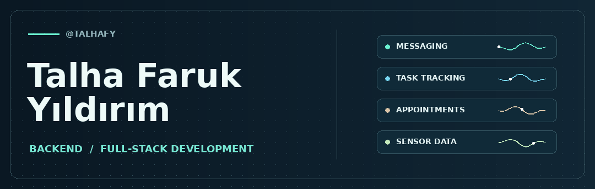

# Talha Faruk Yıldırım

Sakarya Üniversitesi Bilgisayar Mühendisliği öğrencisiyim. Backend ve full-stack geliştirmeye odaklanıyorum. TypeScript ve C# ile mesajlaşma, görev takibi ve randevu yönetimi gibi iş akışlarına yönelik uygulamalar geliştiriyorum.

## Öne çıkan projeler

| Proje | İşlev | Teknoloji |
| --- | --- | --- |
| [Mesajlaşma Uygulaması](https://github.com/Talhafy/mesajlasma-app) | Kullanıcıların birbirlerine mesaj gönderebildiği iletişim uygulaması. | TypeScript |
| [Kanban Board](https://github.com/Talhafy/Kanban-Board) | Görevleri durumlarına göre sütunlarda düzenleyen ve ilerlemeyi görünür kılan Kanban panosu. | TypeScript |
| [Spor Salonu Yönetimi](https://github.com/Talhafy/Web-Programming) | Salon hizmetlerini, antrenör uzmanlıklarını ve üye randevularını yönetmek için geliştirilen web uygulaması. | C# |
| [Akıllı Bitki Sistemi](https://github.com/Talhafy/Smart-Plant-System) | Bitkinin yetişme koşullarını sensör ölçümleriyle izleyen IoT projesi. | ESP8266 |
